<div align="center">

```text
    __    __  ___________    _________    ____  ____  ________ 
   / /   / / / /  _/ ___/   / ____/   |  / __ \/ __ \/  _/ __ \
  / /   / / / // / \__ \   / /   / /| | / /_/ / /_/ // // / / /
 / /___/ /_/ // / ___/ /  / /___/ ___ |/ _, _/ ____// // /_/ / 
/_____/\____/___//____/   \____/_/  |_/_/ |_/_/   /___/\____/  
```

<p align="center">
  
</p>

</div>

```bash
guest@luis-node:~$ neofetch --backend-specs
```

```yaml
host: luisGCarpio @ production-cluster
uptime: 99.98% (zero unhandled exceptions logged today)
kernel: Linux x86_64 / Node.js 20+ LTS / Python 3.11+
shell: bash / zsh / powershell
target_environments: Cloud Containers, Linux Servers, Serverless DBs
status: ACTIVE — Orchestrating APIs, querying databases & hardening endpoints
```

---

### Backend and data

<p align="left">
  
  
  
  
  
  
  
  
  
  
  
  
  
  
  
  
  
  
  
</p>

### Cloud, DevOps and security

<p align="left">
  
  
  
  
  
  
  
  
  
</p>

---

### 🕹️ Pac-Man Contribution Arcade

```bash
guest@luis-node:~$ pacman --arcade-mode --eat-contributions
```

<div align="center">
  <picture>
    <source media="(prefers-color-scheme: dark)" srcset="./pacman-dark.svg">
    <source media="(prefers-color-scheme: light)" srcset="./pacman-light.svg">
    
  </picture>
</div>

---

### 🚀 Production Cluster & Active Services

```bash
guest@luis-node:~$ kubectl get services -o custom-columns=NAME:.metadata.name,STATUS:.status.phase,PORT:.spec.ports
```

<details open>
<summary><b>🟢 <code>wood-api.service</code> — Financial Core & Realtime Balance Engine</b></summary>
<br>

| Metric / Property | Value |
| :--- | :--- |
| **Status** | `● active (running)` — High-Throughput Financial Backend |
| **Stack** | `NestJS 11` · `Prisma 6` · `PostgreSQL (Neon Serverless)` · `Render HTTPS` · `Expo SDK 58` |
| **Endpoints** | `POST /movimientos` (ingreso/gasto en <5s) · `GET /balance/diario` · `GET /metas/progreso` |
| **Highlights** | Diseñado para microempresarios sin fricción contable: calcula utilidades reales sin arqueos manuales ni desbalance de caja. |

</details>

<br>

<details open>
<summary><b>🟢 <code>lasana-erp.service</code> — Multi-Branch Pharmaceutical & Inventory API</b></summary>
<br>

| Metric / Property | Value |
| :--- | :--- |
| **Status** | `● active (running)` — Enterprise POS & Logistics Hub |
| **Stack** | `NestJS` · `Prisma ORM` · `PostgreSQL (Supabase)` · `JWT / RBAC` · `Swagger Docs` |
| **Endpoints** | `POST /pos/checkout` · `GET /inventario/fefo-lotes` · `POST /transferencias/inter-sede` |
| **Highlights** | Política de inventario estricta **FEFO** (*First Expired, First Out*) para evitar vencimiento de medicamentos, auditoría de cajas y control de roles por sucursal. |

</details>

<br>

<details open>
<summary><b>🟢 <code>pysec-flow.service</code> — Micro-SIEM & Threat Detection Engine</b></summary>
<br>

| Metric / Property | Value |
| :--- | :--- |
| **Status** | `● active (running)` — Autonomous Cyber Threat Telemetry |
| **Stack** | `Python 3.11+` · `FastAPI` · `Pydantic v2` · `MITRE ATT&CK` · `AbuseIPDB API` · `SQLite/Postgres` |
| **Endpoints** | `POST /api/v1/ingest` · `GET /api/v1/incidents` · `WS /telemetry/stream` |
| **Highlights** | Correlación en ventanas de tiempo deslizantes para detección de fuerza bruta SSH y escaneos web; enriquecimiento IP con threat intelligence global y alertas automáticas a Telegram. |

</details>

---

### 📡 Ping & Enlaces de Contacto

```bash
guest@luis-node:~$ ping -c 1 contact.network
```

```text
PING contact.network (luistraad@gmail.com): 56 data bytes
64 bytes from luisGCarpio: icmp_seq=1 ttl=64 time=0.042 ms

--- contact.network ping statistics ---
1 packets transmitted, 1 packets received, 0.0% packet loss
```

<div align="center">
  <a href="mailto:luistraad@gmail.com">
    
  </a>
  <a href="https://github.com/luisGCarpio">
    
  </a>
</div>
